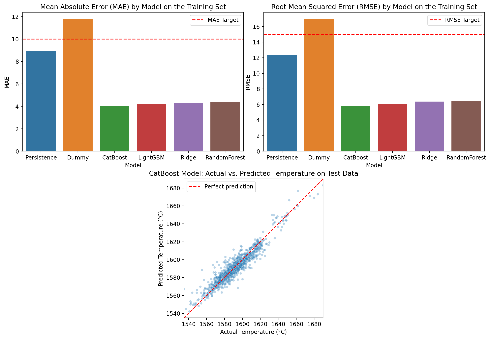

[English](README.md) | [Português (Brasil)](README.pt-BR.md)

# Steelproof — Steel Temperature Prediction

**TripleTen Data Science Bootcamp | Final Project — Sprint 17**

## Project Overview

This project explores the application of machine learning to predict molten steel temperatures during secondary steel refining.

Steel temperature control is an important part of the refining process. Accurate temperature estimates can help operators make informed decisions about heating cycles, energy consumption, and process efficiency.

The objective is to develop a regression model capable of estimating steel temperature using historical temperature measurements and operational data, including electrode heating cycles and material additions.

The proposed solution serves as a preliminary **virtual temperature sensor**, using available process measurements to estimate subsequent steel temperatures.

## Results

**CatBoost achieved the best cross-validation performance**, with a Mean Absolute Error (MAE) of 4.04 °C and a Root Mean Squared Error (RMSE) of 5.82 °C.

On the held-out test set, CatBoost achieved an MAE of **3.93 °C** and an RMSE of **5.59 °C**, reducing prediction errors by approximately 59% and 58%, respectively, compared with the persistence baseline.

### Model Performance Comparison

| Model | CV MAE (°C) | CV RMSE (°C) | Test MAE (°C) | Test RMSE (°C) |
|---|---:|---:|---:|---:|
| **CatBoost** | **4.04** | **5.82** | **3.93** | **5.59** |
| LightGBM | 4.18 | 6.09 | — | — |
| Random Forest | 4.42 | 6.42 | — | — |
| Ridge | 4.30 | 6.38 | — | — |
| Persistence | 8.96 | 12.38 | 9.64 | 13.23 |
| Dummy | 11.79 | 16.97 | — | — |

*Cross-validation metrics were calculated on the training data. The held-out test set was evaluated only for the selected CatBoost model and the persistence baseline. Dashes indicate models not evaluated on the test set.*

### Actual vs. Predicted Temperatures and Cross-Validation Model Comparison



### Key Findings

CatBoost consistently outperformed the other evaluated models during cross-validation and substantially improved upon the persistence baseline on the held-out test set.

These results demonstrate the predictive value of combining historical temperature readings with engineered process features derived from heating operations and material additions.

However, the results reflect performance on historical data. Real-world deployment would require further validation of feature availability at prediction time, operational reliability, and generalization to future production conditions.

### Potential Operational Impact

The proposed model could serve as a virtual temperature sensor during secondary steel refining, providing temperature estimates based on previously recorded measurements and process events.

As an initial deployment strategy, the model should operate alongside conventional temperature measurements to validate its reliability under real operating conditions. Its application could subsequently be evaluated for process conditions adequately represented in the training data, particularly intervals containing electrode heating cycles.

The historical dataset contains **15,907 temperature measurements across 3,216 steel batches**, averaging approximately **4.95 measurements per batch**.

Under a hypothetical scenario in which one manual temperature measurement per batch could safely be replaced by a model-generated estimate, the number of manual measurements would decrease by approximately **20.2%**.

Such a reduction could potentially improve operational efficiency and reduce measurement-related costs. However, the actual benefits cannot be quantified with the available data, as measurement costs, operational constraints, and the metallurgical consequences of replacing measurements are unknown.

Further validation would therefore be necessary before considering the model suitable for replacing conventional temperature measurements.

## Project Objectives

- Explore and evaluate the quality of industrial process data.
- Investigate the relationships between heating operations, material additions, and steel temperature.
- Engineer features that represent the events occurring between temperature measurements.
- Train and tune multiple regression models.
- Evaluate predictive performance using MAE and RMSE.
- Compare model performance against baseline approaches.
- Identify limitations and opportunities for further development.

## Data

The project uses seven datasets provided as part of the TripleTen Steelproof case study.

| Dataset | Description |
|---|---|
| `data_arc_en.csv` | Electrode heating operations, including active and reactive power and heating timestamps. |
| `data_bulk_en.csv` | Quantities of bulk materials added during refining. |
| `data_bulk_time_en.csv` | Timestamps of bulk material additions. |
| `data_gas_en.csv` | Gas consumption measurements. |
| `data_temp_en.csv` | Steel temperature measurements and sampling timestamps. |
| `data_wire_en.csv` | Quantities of wire materials added during refining. |
| `data_wire_time_en.csv` | Timestamps of wire material additions. |

The datasets describe different aspects of the refining process and are linked through batch identifiers.

### Data Preparation and Feature Engineering

A central challenge is that the datasets record different types of events at different times.

Rather than treating each batch as a single observation, the project organizes the data into intervals between consecutive temperature measurements.

Process events occurring within each interval are used to construct features for predicting the subsequent temperature.

Engineered features include:

- Previous temperature measurement.
- Time elapsed between temperature measurements.
- Number and duration of electrode heating cycles.
- Active and reactive power measurements.
- Quantities of bulk and wire materials added.
- Timing of process events relative to temperature measurements.

The datasets undergo exploratory analysis, validation, cleaning, and transformation before modeling.

Gas consumption is not included in the interval-level predictors because the available records do not provide the timestamps necessary to associate consumption with individual intervals.

## Modeling and Evaluation

The project investigates several regression algorithms:

- **DummyRegressor** — baseline based on a simple prediction strategy.
- **Persistence model** — baseline using the previous temperature measurement.
- **Ridge Regression** — regularized linear regression.
- **RandomForestRegressor** - tree ensemble regression.
- **LightGBM** — gradient-boosted decision trees.
- **CatBoost** — gradient-boosted decision trees.

Model development includes cross-validation, hyperparameter tuning, and evaluation on held-out data.

The primary evaluation metrics are:

- **MAE (Mean Absolute Error):** Average absolute difference between predicted and observed temperatures.
- **RMSE (Root Mean Squared Error):** A metric that places greater emphasis on larger prediction errors.

The project also examines prediction distributions, actual-versus-predicted temperatures, and model comparisons.

Detailed experimental results and conclusions are presented in the notebooks.

## Repository Structure

```text
TT-Sprint17-FINAL-PROJECT/
├── README.md
├── environment.yaml
├── assets/
│   └── figures/
│       └── model_diagnostics.png
├── data/
│   ├── data_arc_en.csv
│   ├── data_bulk_en.csv
│   ├── data_bulk_time_en.csv
│   ├── data_gas_en.csv
│   ├── data_temp_en.csv
│   ├── data_wire_en.csv
│   └── data_wire_time_en.csv
└── notebooks/
    ├── 01_steelproof_notebook_work_plan.ipynb
    ├── 02_steelproof_notebook_code.ipynb
    └── 03_steelproof_notebook_report.ipynb
```

The notebooks use relative paths based on the project structure, avoiding dependencies on machine-specific file locations.

## Environment Setup

The project uses Conda to manage Python and its dependencies.

### Prerequisites

- Conda (Miniconda, Anaconda, or equivalent).
- A Jupyter-compatible environment, such as VS Code with the Jupyter extension or JupyterLab.

### 1. Create and activate the project environment

From the repository root directory:

```bash
conda env create -n steelproof -f environment.yaml
conda activate steelproof
```

The environment name `steelproof` can be replaced with any preferred name.

The required Python dependencies are specified in `environment.yaml`, including `ipykernel`.

### 2. Access the notebooks

The project is organized into three notebooks, intended to be read in the following order:

**01 — Work Plan**

`notebooks/01_steelproof_notebook_work_plan.ipynb`

Introduces the business problem, explores the available datasets, investigates preliminary data characteristics, and establishes the proposed methodology and experimental design.

**02 — Data Processing and Modeling**

`notebooks/02_steelproof_notebook_code.ipynb`

Contains the main implementation, including data cleaning, interval construction, feature engineering, regression modeling, hyperparameter optimization, and evaluation.

**03 — Final Report**

`notebooks/03_steelproof_notebook_report.ipynb`

Presents the experimental results, model comparisons, findings, limitations, and recommendations.

### 3. Running the notebooks in VS Code

1. Open the repository folder in VS Code.
2. If using Windows with WSL, open the folder in a WSL session.
3. Open the desired notebook.
4. Select the Jupyter kernel associated with the `steelproof` Conda environment.
5. Execute the notebook cells in order.

**Note:** VS Code generally detects Conda environments directly. Manual kernel registration using `python -m ipykernel install` is typically unnecessary if `ipykernel` is already installed in the selected environment.

Other Jupyter-compatible environments can also be used.

## Project Scope and Limitations

This project represents an exploratory machine learning solution developed using historical industrial process data.

The model is intended to estimate subsequent temperatures based on observed process conditions within the scope of the available data.

It is not presented as a validated production-ready control system. Deployment would require further investigation into measurement reliability, real-time feature availability, generalization to unseen operating conditions, and integration with industrial process controls.

## Author

Developed by **Daniel Endless** as the final project
of the TripleTen Data Science Bootcamp.

[GitHub Profile](https://github.com/danendless)
