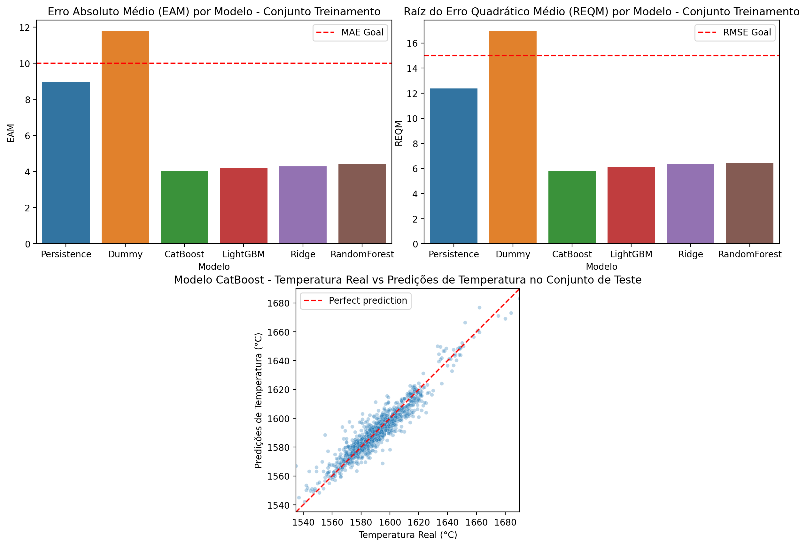

[English](README.md) | [Português (Brasil)](README.pt-BR.md)

# Steelproof — Predição da Temperatura do Aço

**Bootcamp de Ciência de Dados da TripleTen | Projeto Final — Sprint 17**

## Visão Geral do Projeto

Este projeto explora a aplicação de aprendizado de máquina para prever a temperatura do aço líquido durante o refino secundário.

O controle da temperatura do aço é uma parte importante do processo de refino. Estimativas precisas de temperatura podem ajudar os operadores a tomar decisões fundamentadas sobre os ciclos de aquecimento, o consumo de energia e a eficiência do processo.

O objetivo é desenvolver um modelo de regressão capaz de estimar a temperatura do aço com base em medições históricas de temperatura e dados operacionais, incluindo ciclos de aquecimento por eletrodos e adições de materiais.

A solução proposta funciona como um **sensor virtual de temperatura** preliminar, utilizando medições disponíveis do processo para estimar temperaturas subsequentes do aço.

## Resultados

**O CatBoost apresentou o melhor desempenho na validação cruzada**, com erro absoluto médio (MAE) de 4,04 °C e raiz do erro quadrático médio (RMSE) de 5,82 °C.

No conjunto de teste reservado, o CatBoost obteve MAE de **3,93 °C** e RMSE de **5,59 °C**, reduzindo os erros de previsão em aproximadamente 59% e 58%, respectivamente, em comparação com o modelo de persistência.

### Comparação de Desempenho dos Modelos

| Modelo | MAE — Validação Cruzada (°C) | RMSE — Validação Cruzada (°C) | MAE — Teste (°C) | RMSE — Teste (°C) |
|---|---:|---:|---:|---:|
| **CatBoost** | **4,04** | **5,82** | **3,93** | **5,59** |
| LightGBM | 4,18 | 6,09 | — | — |
| Random Forest | 4,42 | 6,42 | — | — |
| Ridge | 4,30 | 6,38 | — | — |
| Persistência | 8,96 | 12,38 | 9,64 | 13,23 |
| Dummy | 11,79 | 16,97 | — | — |

*As métricas de validação cruzada foram calculadas a partir dos dados de treinamento. O conjunto de teste reservado foi utilizado apenas para avaliar o modelo CatBoost selecionado e o modelo de persistência. Os traços indicam modelos não avaliados no conjunto de teste.*

### Temperaturas Reais vs. Previstas e Comparação dos Modelos na Validação Cruzada



### Principais Conclusões

O CatBoost superou consistentemente os demais modelos avaliados durante a validação cruzada e apresentou uma melhoria substancial em relação ao modelo de persistência no conjunto de teste reservado.

Esses resultados demonstram o valor preditivo da combinação de medições históricas de temperatura com atributos derivados de operações de aquecimento e adições de materiais.

No entanto, os resultados refletem o desempenho em dados históricos. Uma implantação em condições reais exigiria validações adicionais da disponibilidade dos atributos no momento da previsão, da confiabilidade operacional e da capacidade de generalização para condições futuras de produção.

### Potencial Impacto Operacional

O modelo proposto poderia funcionar como um sensor virtual de temperatura durante o refino secundário do aço, fornecendo estimativas de temperatura a partir de medições anteriores e eventos do processo.

Como estratégia inicial de implantação, o modelo deveria operar em paralelo com as medições convencionais de temperatura, permitindo validar sua confiabilidade em condições reais de operação. Posteriormente, sua aplicação poderia ser avaliada em condições de processo adequadamente representadas nos dados de treinamento, especialmente nos intervalos que contêm ciclos de aquecimento por eletrodos.

O conjunto de dados históricos contém **15.907 medições de temperatura em 3.216 lotes de aço**, com média de aproximadamente **4,95 medições por lote**.

Em um cenário hipotético no qual uma medição manual de temperatura por lote pudesse ser substituída com segurança por uma estimativa do modelo, o número de medições manuais seria reduzido em aproximadamente **20,2%**.

Essa redução poderia melhorar a eficiência operacional e diminuir os custos associados às medições. Entretanto, não é possível quantificar os benefícios reais com os dados disponíveis, pois não são conhecidos os custos das medições, as restrições operacionais nem as consequências metalúrgicas de sua substituição.

Portanto, seriam necessárias validações adicionais antes de considerar o modelo adequado para substituir medições convencionais de temperatura.

## Objetivos do Projeto

- Explorar e avaliar a qualidade dos dados de processos industriais.
- Investigar as relações entre operações de aquecimento, adições de materiais e temperatura do aço.
- Criar atributos que representem os eventos ocorridos entre medições de temperatura.
- Treinar e ajustar múltiplos modelos de regressão.
- Avaliar o desempenho preditivo utilizando MAE e RMSE.
- Comparar o desempenho dos modelos com abordagens de referência (*baselines*).
- Identificar limitações e oportunidades de desenvolvimento futuro.

## Dados

O projeto utiliza sete conjuntos de dados fornecidos como parte do estudo de caso Steelproof da TripleTen.

| Conjunto de dados | Descrição |
|---|---|
| `data_arc_en.csv` | Operações de aquecimento por eletrodos, incluindo potência ativa, potência reativa e registros de data e hora do aquecimento. |
| `data_bulk_en.csv` | Quantidades de materiais a granel adicionados durante o refino. |
| `data_bulk_time_en.csv` | Registros de data e hora das adições de materiais a granel. |
| `data_gas_en.csv` | Medições de consumo de gás. |
| `data_temp_en.csv` | Medições de temperatura do aço e respectivos registros de data e hora. |
| `data_wire_en.csv` | Quantidades de materiais em fio adicionados durante o refino. |
| `data_wire_time_en.csv` | Registros de data e hora das adições de materiais em fio. |

Os conjuntos de dados descrevem diferentes aspectos do processo de refino e estão relacionados por meio de identificadores de lote.

### Preparação dos Dados e Engenharia de Atributos

Um dos principais desafios é que os conjuntos de dados registram diferentes tipos de eventos em momentos distintos.

Em vez de tratar cada lote como uma única observação, o projeto organiza os dados em intervalos entre medições consecutivas de temperatura.

Os eventos do processo ocorridos dentro de cada intervalo são utilizados para construir atributos que permitem prever a temperatura subsequente.

Os atributos criados incluem:

- Medição anterior de temperatura.
- Tempo decorrido entre medições de temperatura.
- Quantidade e duração dos ciclos de aquecimento por eletrodos.
- Medições de potência ativa e reativa.
- Quantidades de materiais a granel e em fio adicionados.
- Momento dos eventos do processo em relação às medições de temperatura.

Antes da modelagem, os conjuntos de dados passam por análise exploratória, validação, limpeza e transformação.

O consumo de gás não é incluído entre os atributos de cada intervalo, pois os registros disponíveis não contêm as informações temporais necessárias para associar o consumo a intervalos individuais.

## Modelagem e Avaliação

O projeto investiga diversos algoritmos de regressão:

- **DummyRegressor** — modelo de referência baseado em uma estratégia simples de previsão.
- **Modelo de persistência** — modelo de referência que utiliza a medição anterior de temperatura.
- **Regressão Ridge** — regressão linear regularizada.
- **RandomForestRegressor** - regressão com florestas aleatórias.
- **LightGBM** — árvores de decisão com *gradient boosting*.
- **CatBoost** — árvores de decisão com *gradient boosting*.

O desenvolvimento dos modelos inclui validação cruzada, ajuste de hiperparâmetros e avaliação em dados reservados para teste.

As principais métricas de avaliação são:

- **MAE (erro absoluto médio):** média das diferenças absolutas entre as temperaturas previstas e observadas.
- **RMSE (raiz do erro quadrático médio):** métrica que atribui maior peso a erros de previsão maiores.

O projeto também examina as distribuições das previsões, a relação entre temperaturas reais e previstas e as comparações entre modelos.

Os resultados experimentais detalhados e as conclusões são apresentados nos notebooks.

## Estrutura do Repositório

```text
TT-Sprint17-FINAL-PROJECT/
├── README.md
├── README.pt-BR.md
├── environment.yaml
├── assets/
│   └── figures/
│       └── model_diagnostics.png
├── data/
│   ├── data_arc_en.csv
│   ├── data_bulk_en.csv
│   ├── data_bulk_time_en.csv
│   ├── data_gas_en.csv
│   ├── data_temp_en.csv
│   ├── data_wire_en.csv
│   └── data_wire_time_en.csv
└── notebooks/
    ├── 01_steelproof_notebook_work_plan.ipynb
    ├── 02_steelproof_notebook_code.ipynb
    └── 03_steelproof_notebook_report.ipynb
```

Os notebooks utilizam caminhos relativos com base na estrutura do projeto, evitando dependências de diretórios específicos de uma máquina.

## Configuração do Ambiente

O projeto utiliza Conda para gerenciar o Python e suas dependências.

### Pré-requisitos

- Conda (Miniconda, Anaconda ou equivalente).
- Um ambiente compatível com Jupyter, como VS Code com a extensão Jupyter ou JupyterLab.

### 1. Criar e ativar o ambiente do projeto

No diretório raiz do repositório, execute:

```bash
conda env create -n steelproof -f environment.yaml
conda activate steelproof
```

O nome `steelproof` pode ser substituído por outro de sua preferência.

As dependências Python necessárias estão especificadas em `environment.yaml`, incluindo `ipykernel`.

### 2. Acessar os notebooks

O projeto está organizado em três notebooks, que devem ser lidos na seguinte ordem:

**01 — Plano de Trabalho**

`notebooks/01_steelproof_notebook_work_plan.ipynb`

Apresenta o problema de negócio, explora os conjuntos de dados disponíveis, investiga características preliminares dos dados e estabelece a metodologia e o planejamento experimental propostos.

**02 — Processamento de Dados e Modelagem**

`notebooks/02_steelproof_notebook_code.ipynb`

Contém a implementação principal, incluindo limpeza de dados, construção de intervalos, engenharia de atributos, modelagem de regressão, otimização de hiperparâmetros e avaliação.

**03 — Relatório Final**

`notebooks/03_steelproof_notebook_report.ipynb`

Apresenta os resultados experimentais, as comparações entre modelos, as conclusões, as limitações e as recomendações.

### 3. Executar os notebooks no VS Code

1. Abra a pasta do repositório no VS Code.
2. Se estiver utilizando Windows com WSL, abra a pasta em uma sessão WSL.
3. Abra o notebook desejado.
4. Selecione o kernel Jupyter associado ao ambiente Conda `steelproof`.
5. Execute as células do notebook em ordem.

**Observação:** O VS Code geralmente detecta ambientes Conda diretamente. O registro manual do kernel por meio de `python -m ipykernel install` normalmente é desnecessário se o pacote `ipykernel` já estiver instalado no ambiente selecionado.

Também é possível utilizar outros ambientes compatíveis com Jupyter.

## Escopo e Limitações do Projeto

Este projeto representa uma solução exploratória de aprendizado de máquina desenvolvida a partir de dados históricos de um processo industrial.

O modelo tem como objetivo estimar temperaturas subsequentes com base nas condições observadas do processo, dentro do escopo dos dados disponíveis.

Ele não é apresentado como um sistema de controle pronto para uso em produção. Uma implantação exigiria investigações adicionais sobre a confiabilidade das medições, a disponibilidade dos atributos em tempo real, a capacidade de generalização para condições operacionais não observadas e a integração com os sistemas de controle industrial.

## Autor

Desenvolvido por **Daniel Endless** como projeto final do Bootcamp de Ciência de Dados da TripleTen.

[Perfil no GitHub](https://github.com/danendless)
